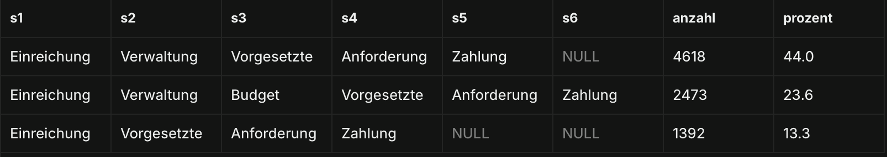
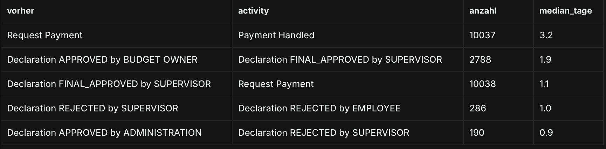
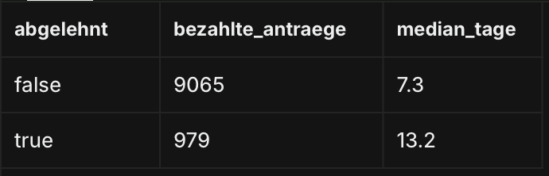

# Prozessanalyse: Reisekostenerstattung

Wie läuft die Erstattung ab, wo wird gewartet und wie hängen
Ablehnungen mit der Dauer zusammen?

**Daten:** realer, anonymisierter Event Log der TU Eindhoven mit
10.500 Anträgen und 56.437 Ereignissen (BPI Challenge 2020,
Domestic Declarations)
**Werkzeuge:** SQL, Supabase (PostgreSQL), Python für die Umwandlung

## Ergebnisse

### 1. Ein Standardweg deckt 44 % der Fälle ab

Einreichung, Freigabe durch Verwaltung und Vorgesetzte, Zahlung. Die drei häufigsten Wege decken zusammen rund 81 % der Anträge ab.  

### 2. Der längste Median liegt vor der Zahlung

Von der Zahlungsanforderung bis zur Zahlung vergehen im Median
3,2 Tage (Übergänge mit mindestens 100 Fällen).

### 3. Anträge mit Ablehnung dauern länger

Bis zur Zahlung vergehen im Median 13,2 statt 7,3 Tage.

## Empfehlung

Häufige Ablehnungsgründe ermitteln und prüfen, welche Fehler sich
schon bei der Eingabe vermeiden lassen.

## Grenzen

- Das Log enthält keine Ablehnungsgründe.
- Ergebnis 3 zeigt einen Zusammenhang, keine bewiesene Ursache.
- Die Zeiten enthalten auch Wochenenden.
- Durchlaufzeiten berücksichtigen nur bezahlte Anträge.

## Vorgehen

1. Event Log von XES in CSV umgewandelt
2. Daten in Supabase importiert und Anzahl der Zeilen geprüft
3. Varianten, Wartezeiten und Ablehnungen mit SQL ausgewertet

Die Abfragen stehen in [abfragen.sql](abfragen.sql).

## Einsatz von KI

Umwandlungsskript, SQL-Entwürfe und README-Vorlage entstanden mit
KI-Unterstützung. Import und Ausführung der Abfragen habe ich selbst 
durchgeführt und die Ergebnisse mit einer KI-gestützten Kontrollrechnung 
abgeglichen.

## Datenquelle

Die Rohdaten sind nicht enthalten. Zum Ausführen von `umwandeln.py`
die Datei `DomesticDeclarations.xes.gz` in einen Ordner `daten` legen.
[BPI Challenge 2020](https://icpmconference.org/2020/bpi-challenge/)